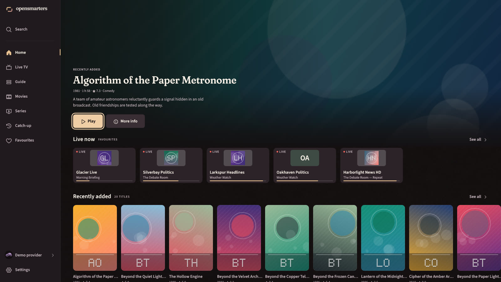
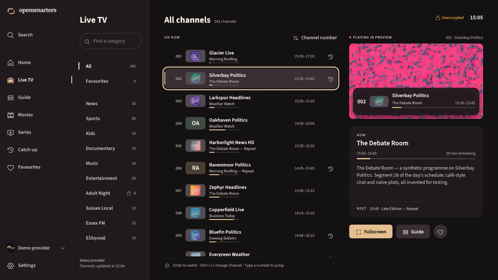
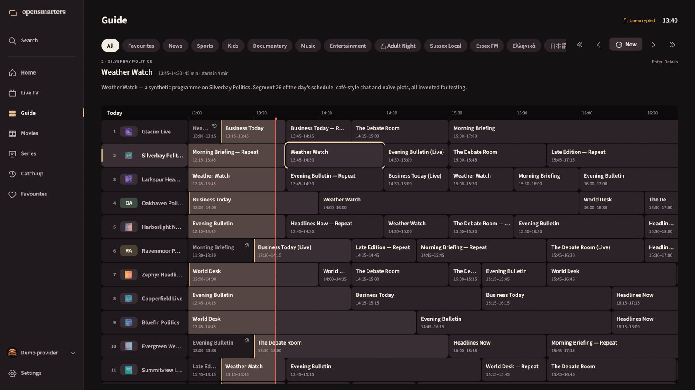
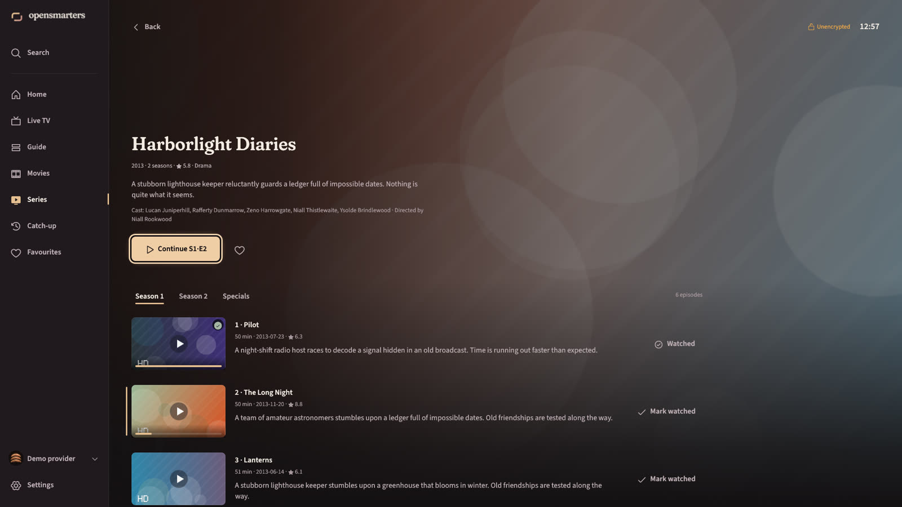

# opensmarters

**A secure, open-source IPTV player for Windows, built in Rust.** It works with your own Xtream Codes or M3U subscription. It's fast with large catalogues, comfortable from the sofa, and treats your provider's data as untrusted.



opensmarters ships with **no channels, no content and no provider**. It plays what your own subscription gives you. It is an independent project: it is not affiliated with IPTV Smarters or WHMCS Smarters, and it uses none of their code.

## Features

- **Live TV**:
  - categories, plus All and Favourites;
  - a virtualised channel list that stays smooth with 10,000+ channels;
  - now/next EPG with progress, and an inline preview player;
  - a channel banner when zapping, and channel-number entry.
- **Guide**: an EPG grid from the provider's API or XMLTV (including `url-tvg`). It loads lazily and with bounded resources.
- **Catch-up**: 14 days of archive, grouped by day on your clock. If a provider rejects the usual timeshift link format, the app retries once with the other one.
- **Movies and Series**:
  - loaded per category, so a 35,000-title catalogue never blocks the UI;
  - detail pages and seasons;
  - **resume**, **Continue watching**, and **next episode**.
- **Search** across channels, films, series and cached programmes, plus **Favourites** with reordering.
- **Category management**: per profile, hide the categories you never watch, put the rest in your own order, and show only some regions ("FR | Sports", "[UK] News"). Press H on a category to hide it, or open Settings › Categories.
- **Player** (libmpv, hardware decoding):
  - audio and subtitle tracks, aspect and zoom presets;
  - stall detection with bounded reconnects;
  - respect for your provider's connection limit.
- **Pause and rewind live TV**, per-stream buffering that tunes itself to each channel, and a stream details overlay (D).
- **Recordings and downloads**:
  - download films and episodes to watch offline; downloads resume, and step aside when you need the connection to watch;
  - record live TV now, or on a schedule from the Guide or Search;
  - save the last minutes of a live channel as a clip;
  - a Recordings screen; saved items go to `Videos\opensmarters` and follow parental locks.
- **Multiscreen** 1×2 and 2×2, with the sound following the focused tile, within your connection limit.
- **Sleep timer** (after this episode, or 30/60 minutes, with a fade and "Still watching?") and **programme reminders** from the Guide (notify, or switch channel when it starts).
- **Parental control**:
  - a 4–8 digit PIN, Argon2-hashed and rate-limited;
  - locked words matched as whole words ("Sussex" is fine);
  - per-category locks enforced everywhere: browse, Search, Home, Favourites, Guide, the player.
- **Multiple profiles** (Xtream, M3U URL, M3U file); backup and restore without secrets.
- **Keyboard and remote first**: spatial navigation everywhere, a TV mode (10-foot UI), and full mouse support.

| | |
|---|---|
|  |  |
|  | |

*(Screenshots use the built-in synthetic demo provider.)*

## Security

Everything a provider sends (names, artwork, EPG, playlists, stream links) is untrusted input, and none of it must ever be able to run code on your PC. opensmarters is designed against that whole class of problems:

- **Native UI.** egui renders provider text as text; there's no HTML or JS engine.
- **Locked-down libmpv.** No scripts, no config files, no youtube-dl.
- **Stream links are checked.** A scheme allowlist applies before anything reaches mpv, and the protocol whitelist covers HLS sub-requests.
- **Secrets stay in Windows Credential Manager.** Passwords and playlist URLs never go in files or logs, and every log line is redacted.
- **TLS is always verified.** `https`→`http` redirects are refused, and plain-HTTP accounts are flagged.
- **No telemetry.** The app talks to your provider and nothing else, unless you ask: movie-database (TMDB) lookups are off by default, and GitHub is asked for the latest version number only when you choose **Check for updates** (or turn on the weekly check). GitHub sees your IP address; nothing else is sent, and nothing is downloaded or installed.
- **Hostile input is bounded.** Size, memory and time limits apply to playlists, EPG and artwork. The parsers are fuzzed.

The threat model, mitigations and review findings are in [docs/SECURITY.md](docs/SECURITY.md).

## Install

Get the latest version from [Releases](https://github.com/frozenshieldweb/opensmarters/releases/latest) or the [download page](https://frozenshieldweb.github.io/opensmarters/).

Download `opensmarters-<version>-windows-x64-setup.exe` and run it. It installs for your Windows account only (no administrator rights) into `%LOCALAPPDATA%\Programs\opensmarters` and adds a Start menu shortcut; **Options** picks another folder or adds a desktop shortcut. Running a newer setup updates in place (Settings › About › **Check for updates** tells you when there is one; the app never downloads it for you). Remove it from Windows Settings → Apps: your data and saved passwords stay unless you tick the boxes, and recordings in your Videos folder always stay. For scripted installs, `--quiet` (see `--help`).

Or use the portable zip: download `opensmarters-<version>-windows-x64.zip`, unzip it anywhere and run `opensmarters.exe`, keeping `libmpv-2.dll` next to it.

Windows 10/11 x64 with a current graphics driver is required. Builds are not signed yet, so Windows may warn about an unknown publisher; signing is on its way ([code signing policy](docs/CODE_SIGNING.md)).

**Check a download.** Every release lists the SHA-256 of its files in `SHA256SUMS.txt` (`Get-FileHash <file>` in PowerShell). The files are built by GitHub Actions from the tagged source, with a signed build-provenance attestation you can check with the GitHub CLI: `gh attestation verify <file> --repo frozenshieldweb/opensmarters`.

Your data lives in `%LOCALAPPDATA%\opensmarters\opensmarters\data`. Passwords are in Windows Credential Manager, under entries ending in `.opensmarters`.

## Keyboard

| | Everywhere | Live TV | Player |
|---|---|---|---|
| Move / select | Arrows, Enter | | |
| Back | Esc or Backspace | | |
| Change channel | | Ctrl+↓ next / Ctrl+↑ previous | PageUp / PageDown (or ↑/↓ with controls hidden) |
| Channel number | | digits | digits |
| Page the list | | PageUp / PageDown | |
| Play / pause, seek | | | Space; ←/→ 10 s (Shift: 60 s) |
| Mute, fullscreen, info | | M, F, I | M, F, I |
| Audio / subtitles | | | A / S |

## Build from source

Requirements:
- Windows 10/11 x64
- Rust 1.95 or newer (MSVC toolchain); `rust-toolchain.toml` pins 1.99.1, which rustup installs automatically
- PowerShell

```powershell
# 1. Fetch the pinned libmpv build (hash-verified) into vendor/libmpv/
powershell -ExecutionPolicy Bypass -File tools\fetch-libmpv.ps1

# 2. Run the app
cargo run -p opensmarters --release

# Try it without an account: the built-in synthetic provider, in memory only
cargo run -p opensmarters --features demo -- --demo --ephemeral
```

**Developer workflow:** for the scripted UI harness (screenshots, key scripts), build with `--features demo,harness`; see [docs/APP_ARCHITECTURE.md](docs/APP_ARCHITECTURE.md) §9.

**Checks:**
```powershell
cargo fmt --all -- --check
cargo clippy --workspace --all-targets --all-features -- -D warnings
cargo test --workspace --all-features
cargo deny check; cargo audit
```

**Release files:** `powershell -ExecutionPolicy Bypass -File tools\package.ps1` writes `dist/`: the portable zip, the setup exe (built from the same files) and `SHA256SUMS.txt`. It needs `cargo install --locked cargo-about --features cli`.

## Project layout

| Path | What |
|---|---|
| `crates/core` | Xtream client, lenient models, M3U and XMLTV parsers, stream URLs, log redaction |
| `crates/store` | SQLite storage, keychain secrets, encrypted cache, Argon2id PIN |
| `crates/player` | Hardened libmpv wrapper and the egui video view (the only crate with `unsafe`) |
| `crates/app` | The desktop app (eframe/egui) |
| `crates/afterglow` | The Afterglow theme, icons and painting helpers, shared by the app and the installer |
| `crates/installer` | `opensmarters-setup`, the per-user Windows installer ([ADR 0002](docs/adr/0002-installer.md)) |
| `crates/fake-panel` | A synthetic provider for development and tests |
| `site/` | The landing page (static; [site/README.md](site/README.md)) |
| `tools/assets/` | The launch-asset pipeline (Codex image generation, then a deterministic build into `assets/launch/`) |
| `docs/` | [Architecture](docs/APP_ARCHITECTURE.md), [design system](docs/DESIGN.md), [protocol](docs/PROTOCOL.md), [security](docs/SECURITY.md), [libmpv](docs/LIBMPV.md), [progress](docs/PROGRESS.md) |

## Licence

opensmarters is free software under the **GNU General Public License v3.0 or later** (see [LICENSE](LICENSE)). Release builds bundle a GPL build of libmpv/FFmpeg; source links are in [packaging/THIRD_PARTY.md](packaging/THIRD_PARTY.md). The fonts (Source Sans 3, Fraunces) are under the SIL OFL 1.1, and the Phosphor icons are under MIT.
