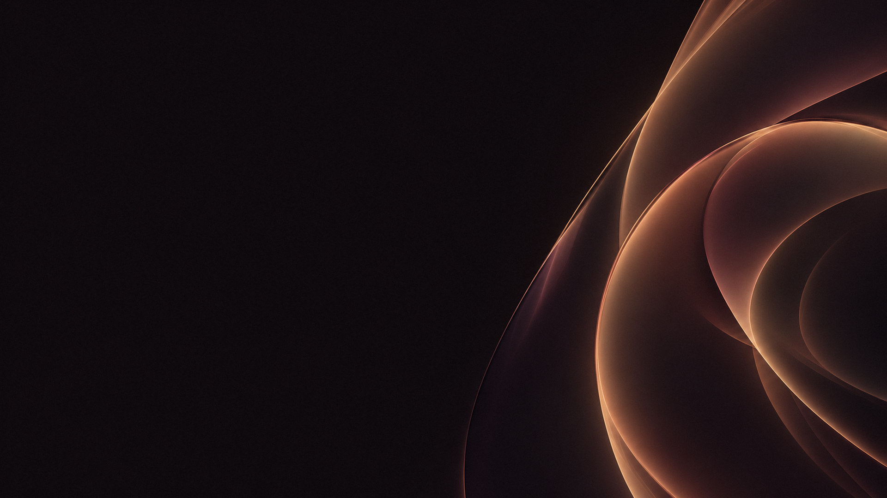
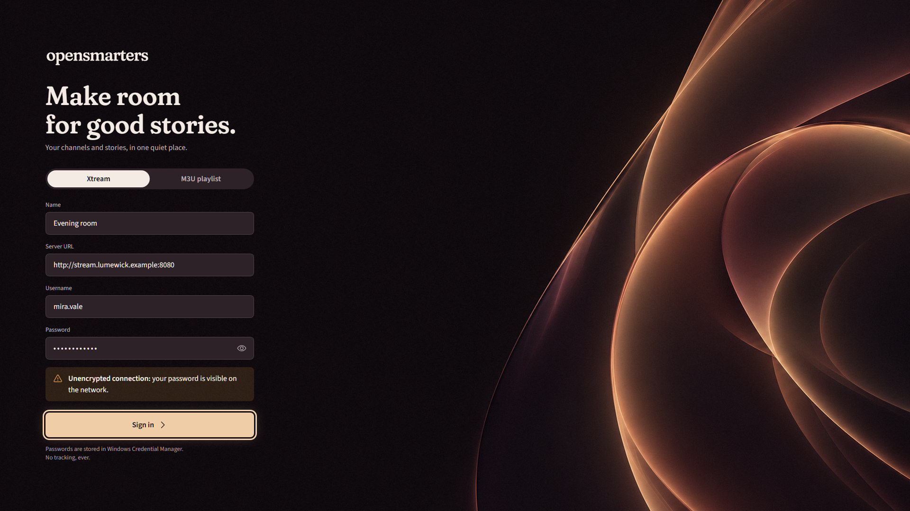
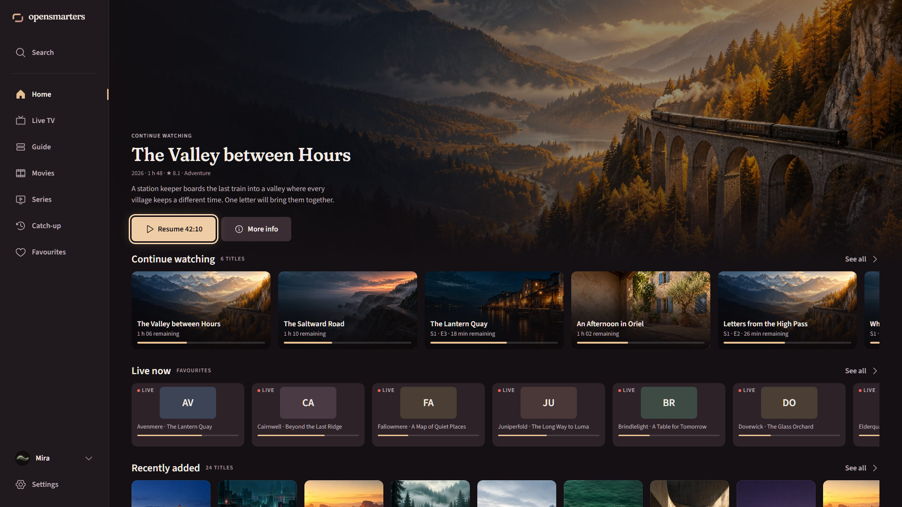
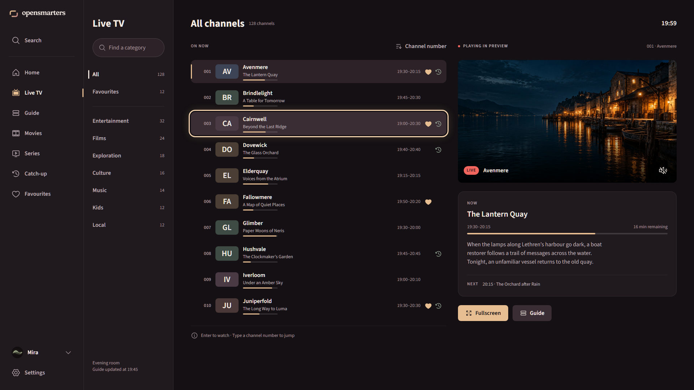
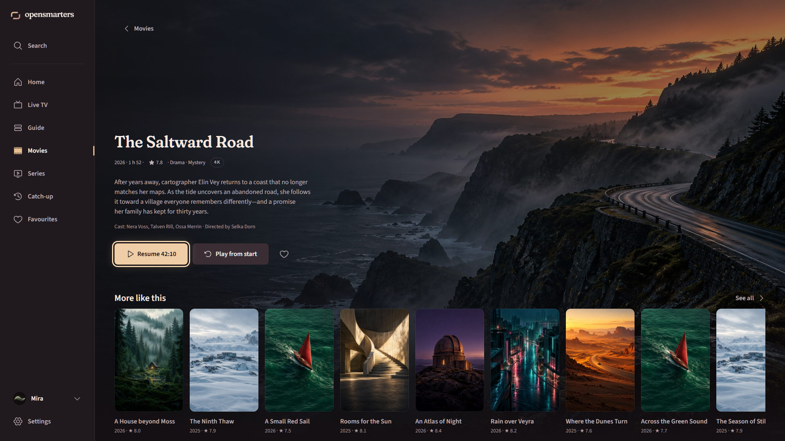
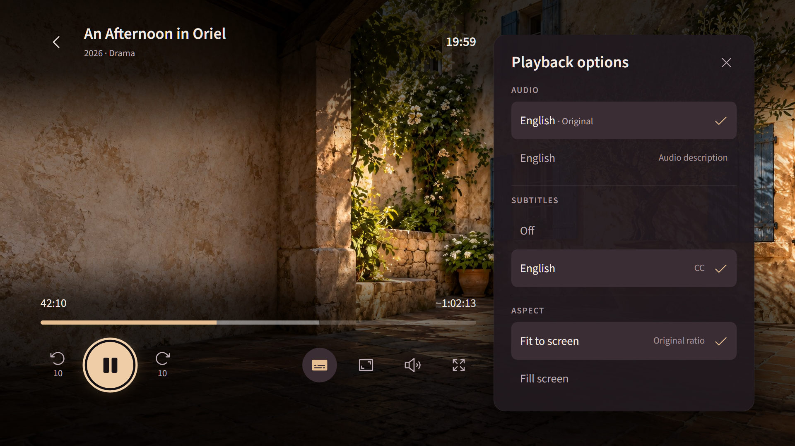

# opensmarters design system: "Afterglow"

Status: v1 (2026-10-20). Owner: design. Scope: everything visual in `crates/app`.
Assets live in [`assets/`](../assets/) (provenance in [`assets/README.md`](../assets/README.md)). Concept mockups are in [`assets/concepts/`](../assets/concepts/).
This document is the contract. If something here is impossible in egui, change the doc in the same PR as the code.



---

## 1. Direction

**Afterglow** is the quiet warmth left in a cinema after the picture fades. The UI is a deep, warm near-black room. Content (posters, video) supplies the colour, and the interface adds only a little champagne light where your attention is.

- **Calm.** One accent colour, generous dark space, nothing blinks or autoplays. The focused item is the only bright thing on screen.
- **Cinematic.** Warm darks that are kind to the eyes in a dim living room at night; a soft display serif (Fraunces) for titles; softly bowed light planes in the key art.
- **Trustworthy.** High-contrast text (AA everywhere, mostly AAA), plain language, explicit privacy and security states (for example the "unencrypted connection" warning). No dark patterns.
- **Its own.** It avoids the red, blue and orange of the big streamers: the signature is *champagne on warm ink*. Nothing in it echoes IPTV Smarters' branding.

Rules of thumb:
1. **One light source per screen**: the focused element gets the champagne ring and glow. Nothing else uses the accent at full strength, except the primary button and progress fills.
2. **Text never sits directly on bright imagery.** Use a token surface or the scrims in §4.6.
3. **Dark first, and dark only for v1.** Do not ship a light theme until it has been designed.

---

## 2. Brand marks


**The symbol, "Open corners":** a 5:4 screen frame whose two diagonal corners are left open. It reads as a screen of your own with nothing closed off (open source, no lock-in), and it echoes the open "o" of the wordmark. Champagne flows into muted rose along the diagonal (the afterglow).

| Asset | File | Use |
|---|---|---|
| App icon (plate + symbol) | `assets/icon/opensmarters.ico` (16, 24, 32, 48, 64, 128, 256), `icon-256.png`, `icon-1024.png` | Windows exe/taskbar icon, eframe window icon, About screen. 16/24/32 px frames are hand-hinted pixel masters. |
| Symbol (champagne→rose, transparent) | `assets/brand/symbol.png` (512 px) | In-app mark: side-rail top (28 pt), player idle screen (64 pt at 60% opacity via `Image::tint`), loading screen |
| Wordmark | `assets/brand/wordmark.png` (713×117 px, transparent, cream `#F4ECE4`) | Login/onboarding header, side rail (expanded), About |
| Lockup (symbol + wordmark) | `assets/brand/lockup.png` (856×129 px, transparent) | Splash, login header on wide layouts, README |
| Vector sources (not embedded) | `assets/icon/icon.svg`, `icon-16/24/32.svg`, `assets/brand/symbol.svg` (flat), `symbol-gradient.svg` | Re-rendering, packaging, website |

- The wordmark is always lowercase **opensmarters**, set in Fraunces (opsz 144, wght 560, SOFT 100, WONK 0, tracking -1%) and pre-rendered. Never re-type it with the UI font, never split it into two colours, and never put "IPTV" next to it.
- **Clear space:** at least half the symbol's height on all sides.
- **Display size:** treat the PNGs as @2x and draw them at ≤ 50% of their pixel size in points (wordmark ≈ 356×58 pt maximum; 20-36 pt tall in UI). Minimum wordmark height is 16 pt. The minimum symbol size is 16 px, using the `.ico`'s hinted frame.
- On imagery, place marks only on the dark side of the hero or on a scrim.

---

## 3. Scale model: one layout, two densities

egui works in logical points. We design **once, in points**, and switch density with `ctx.set_zoom_factor()`:

| Mode | When | Zoom | Logical canvas at 1920×1080 | Notes |
|---|---|---|---|---|
| **Desktop** | windowed, mouse/keyboard | `1.0` (× OS scale via `pixels_per_point`) | 1920 × 1080 pt at 100% Windows scaling | Default |
| **TV / couch** | fullscreen + "TV mode" setting (or `--tv`), remote/gamepad | `zoom = (screen_width_px / native_ppp) / 1100` → **≈ 1.75 at 1080p** | ≈ 1100 × 620 pt | Same layouts, everything 1.75× bigger; body text becomes 28 px |

Layout breakpoints use the **available logical width** of the root panel, so TV mode automatically lands in "medium":

| Breakpoint | Width (pt) | Side rail | Poster width | Page margin |
|---|---|---|---|---|
| compact | < 960 | hidden; top bar with menu button | 132 | 24 |
| medium | 960-1439 | collapsed (72 pt), expands over content on focus | 148 | 40 |
| wide | ≥ 1440 | expanded (232 pt) | 168 | 48 |

**TV safe area:** in TV mode keep all focusable content inside 5% horizontal / 5% vertical insets (≈ 56 × 32 pt at zoom 1.75). Backgrounds and backdrops bleed to the edge.

---

## 4. Tokens

All values are in **points** unless marked px. Hex is sRGB, and alpha is noted as `@n%`. Code: `Color32::from_rgb(..)` / `Color32::from_rgba_unmultiplied(..)` (egui colours are premultiplied, so never construct alpha colours with `from_rgba_premultiplied` by hand).

### 4.1 Colour: surfaces

| Token | Hex | Use | egui field |
|---|---|---|---|
| `bg` | `#141013` | app background, central panel | `visuals.panel_fill` |
| `bg-deep` | `#0D0A0C` | wells behind lists, EPG background, below the hero | `visuals.extreme_bg_color` |
| `video` | `#000000` | behind video only | n/a |
| `surface-1` | `#20191E` | side rail, settings panes, dialogs, menus | `visuals.window_fill`, `widgets.noninteractive.bg_fill` |
| `surface-2` | `#2C2228` | cards, inputs, list rows (rest), chips | `widgets.inactive.bg_fill`/`weak_bg_fill`, `text_edit_bg_color` |
| `surface-3` | `#3A2D34` | hovered/focused rows, secondary buttons, selected cell | `widgets.hovered.bg_fill` |
| `surface-4` | `#4A3A43` | pressed, toggle track (off) | `widgets.active.bg_fill` |
| `stroke-subtle` | `#FFFFFF @8%` (on bg ≈ `#272326`) | hairlines, dividers, card edges | `widgets.noninteractive.bg_stroke` |
| `stroke` | `#FFFFFF @14%` | input borders, outlines | `widgets.inactive.bg_stroke` |
| `scrim` | `#0D0A0C @72%` | modal backdrop, text over imagery | n/a |

### 4.2 Colour: text, accent, status

| Token | Hex | Use | Contrast (on bg / s1 / s2 / s3) |
|---|---|---|---|
| `text` | `#F4ECE4` | primary text; icons and labels when focused | 16.1 / 14.7 / 13.2 / 11.2 (AAA) |
| `text-2` | `#BFAFB6` | secondary text, synopsis, inactive nav labels | 9.0 / 8.2 / 7.3 / 6.3 (AAA/AA) |
| `text-3` | `#A8989E` | metadata, timestamps, placeholders | 6.9 / 6.3 / 5.6 / 4.8 (AA) |
| `text-disabled` | `#6E6168` | disabled labels only (never essential info) | 2.9 on s1 (exempt) |
| `text-on-accent` | `#1A1316` | text/icons on accent, live, cream fills | 10.6 on accent, 15.6 on cream |
| `accent` | `#E6BE91` | **champagne**: primary button, progress, selected icon, links | 10.9 / - / 8.9 / 7.6 |
| `accent-hover` | `#EFCDA6` | primary hover | |
| `accent-pressed` | `#D4A877` | primary pressed | |
| `accent-soft` | `#E6BE91 @16%` (≈ `#403330` on s1) | selection background, EPG elapsed tint | text on it: 10.7 |
| `focus` | `#F2D3AE` | focus ring | 12.1 on s1, 7.4 on s4 (≥ 3:1 required) |
| `focus-glow` | `#E6BE91 @28%` | focus outer glow (shadow colour) | |
| `sage` | `#A4B6A4` | secondary accent: catch-up available, "new" tags, info chips | 7.2 on s2 |
| `cream` | `#F4ECE4` | selected chip/segment fill (with `text-on-accent`) | |
| `live` | `#F0665E` | live dot, LIVE badge fill, EPG now-line | dot 5.6 on s1; badge text `text-on-accent` 5.9 |
| `danger` | `#F28B82` | error text/icons, destructive button text | 6.4 on s2 |
| `danger-bg` | `#F28B82 @14%` (≈ `#3D292C`) | error callout fill | |
| `warning` | `#F0A848` | warnings (e.g. HTTP/unencrypted) | 7.6 on s2 |
| `warning-bg` | `#F0A848 @14%` (≈ `#3D2D24`) | warning callout fill | text on it 11.2 |
| `success` | `#8FC79A` | connected, saved, valid | 8.9 on s1 |
| `info` | `#9FB4D6` | neutral notices | 8.2 on s1 |

Rules: status colours always come with an icon and a word, never colour alone. Live red appears only on live indicators.

### 4.3 EPG colours

| Token | Value |
|---|---|
| `epg-bg` | `bg-deep` |
| `epg-cell` | `surface-2`; past programmes `surface-1` with `text-3` titles |
| `epg-cell-now` | `surface-3` + elapsed part tinted `accent-soft` + 3 pt `accent` bar on the left edge |
| `epg-now-line` | `live`, 2 pt, full grid height, with a 6 pt dot on the time ruler |
| `epg-progress` | track `#FFFFFF @14%`, fill `accent`, 4 pt high, radius 2 |
| `epg-catchup` | `sage` icon (`clock-counter-clockwise`) on cells/rows with archive |

### 4.4 Spacing, radii, strokes

**Spacing scale (pt):** `2, 4, 8, 12, 16, 24, 32, 48, 64, 96`. Default gap inside components 8; between cards 16; between rails 32; page margin per breakpoint (§3).

| Radius token | pt | Use |
|---|---|---|
| `r-xs` | 4 | tags, progress bars, EPG cells (small) |
| `r-sm` | 8 | buttons, inputs, menu items, EPG cells |
| `r-md` | 12 | cards (poster/backdrop/channel), list rows, toasts |
| `r-lg` | 16 | dialogs, OSD panels, track menu, login card |
| `r-xl` | 24 | sheets, large hero containers |
| `r-full` | 255 | pills, chips, avatars, icon buttons |

| Stroke token | pt |
|---|---|
| `hairline` | 1 |
| `control` | 1.5 (input/outline buttons) |
| `focus-ring` | 3 (+ 3 pt gap between element and ring) |
| `progress` | 4 (OSD scrubber 6, 10 when focused) |

### 4.5 Elevation (egui `epaint::Shadow { offset: [i8; 2], blur: u8, spread: u8, color }`)

| Token | offset | blur | spread | colour | Use |
|---|---|---|---|---|---|
| `e0` | - | - | - | none | flat surfaces |
| `e1` | `[0, 6]` | 18 | 0 | black @45% (`from_black_alpha(115)`) | focused/lifted cards |
| `e2` | `[0, 10]` | 28 | 0 | black @55% (`140`) | menus, popups (`visuals.popup_shadow`) |
| `e3` | `[0, 18]` | 48 | 4 | black @65% (`166`) | dialogs, track menu (`visuals.window_shadow`) |
| `glow-focus` | `[0, 0]` | 24 | 2 | `focus-glow` (`from_rgba_unmultiplied(230,190,145,72)`) | painted behind the focused element |

### 4.6 Imagery, scrims and asset usage

| Asset | File | Size | How to use |
|---|---|---|---|
| Login/onboarding hero | `assets/backgrounds/hero.jpg` | 1920×1080 | Cover-fit, **anchored right** (crop from the left). Left 55% is pre-darkened (mean luma 12/255). On windows narrower than 16:9 add `scrim-left` (below). |
| Ambient home background | `assets/backgrounds/home-ambient.jpg` | 1920×1080 | Behind Home/browse when there is no focused backdrop. Already dimmed (max luma 52/255); no scrim needed. |
| Player idle backdrop | `assets/backgrounds/player-idle.jpg` | 1920×1080 | Player screen when nothing is playing / between streams; centre the mono symbol (64 pt, 60% opacity) + status text in `text-2`. |
| Poster placeholder | `assets/placeholders/poster.jpg` | 400×600 | While loading or when the provider has none. Draw the title centred (Fraunces 20, `text-2`, 3 lines max) over it. |
| Backdrop placeholder | `assets/placeholders/backdrop.jpg` | 1280×720 | 16:9 card / detail backdrop fallback. |
| Channel logo fallback | `assets/placeholders/channel-logo.png` | 256×256, transparent | When no logo: prefer a runtime monogram tile (§6.4); this PNG is the last resort. |
| Avatars | `assets/avatars/avatar-1..6.jpg` | 256×256 | Profile picker. Clip to a circle (`Image::corner_radius(size/2)`). |
| Empty/error illustrations | `assets/illustrations/*.png` | 512×512, transparent | Empty states (§6.13); display at 200 pt desktop (≈ 350 px TV). |

**Scrims** (draw with a vertex-coloured mesh, see §9.5):
- `scrim-left`: horizontal gradient `bg @92%` at x=0 to `bg @0%` at 60% width, used for text over backdrops on the detail page and the Home hero band.
- `scrim-bottom`: vertical gradient `bg @0%` to `bg @100%` over the bottom 40% of a backdrop, blending it into the page.
- `scrim-osd-top`: black 80% → 72% → 0% over 200 pt (TV) / 160 pt (desktop); `scrim-osd-bottom`: black 85% → 78% → 60% → 0% (bottom to top) over 260 pt. See §6.10.
- Provider backdrops behind Home/detail: also apply `tint(Color32::from_gray(150))` (≈ -40% brightness) before scrims.

### 4.7 Typography

**Families (both SIL OFL 1.1, shipped unmodified in `assets/fonts/`):**
- **Source Sans 3** (variable, `wght` 200-900): all UI text. Chosen because its **default digits are tabular** (egui does no OpenType shaping, so `tnum` can't be switched on). Clocks, timecodes, channel numbers and EPG times won't jitter. It also covers Latin-ext, Cyrillic, Greek and Vietnamese, which IPTV channel names need. **The variable default instance is ExtraLight (200), so you must set `wght` coords** (see §9.2).
- **Fraunces** (variable: `opsz`, `wght`, `SOFT`, `WONK`): display only (titles ≥ 28 pt, hero copy, profile picker heading, empty-state headlines). Always `opsz 72, wght 560, SOFT 100, WONK 0`. **Its default instance is Black/wonky, so coords are mandatory.** Never use it for numbers, lists, buttons or the EPG.

**Type ramp** (pt; the TV column is px at 1080p with zoom 1.75):

| Token | egui `TextStyle` | Family / weight | Size | Line height | TV px | Use |
|---|---|---|---|---|---|---|
| `caption` | `Small` | Source Sans 3 / 400 | 13 | 18 | 23 | metadata, timestamps, helper text |
| `overline` | `Name("overline")` | Source Sans 3 / 600, +8% letter-spacing, UPPERCASE | 12 | 16 | 21 | badges (LIVE, NEW, HD), section kickers |
| `body` | `Body` | Source Sans 3 / 400 | 16 | 24 | 28 | default text, synopsis |
| `body-strong` | `Name("body-strong")` | Source Sans 3 / 600 | 16 | 24 | 28 | list titles, channel names |
| `button` | `Button` | Source Sans 3 / 600 | 16 | 20 | 28 | buttons, chips, tabs |
| `title-sm` | `Name("title-sm")` | Source Sans 3 / 600 | 18 | 24 | 31 | card titles on focus, dialog titles (compact) |
| `title` | `Name("title")` | Source Sans 3 / 600 | 22 | 28 | 38 | rail headings ("Continue watching"), dialog titles |
| `heading` | `Heading` | Source Sans 3 / 700 | 28 | 34 | 49 | screen titles (Settings, Movies) |
| `display` | `Name("display")` | Fraunces 72/560/100/0 | 40 | 46 | 70 | detail-page title, Home hero title, "Who's watching?" |
| `hero` | `Name("hero")` | Fraunces 72/560/100/0 | 56 | 60 | 98 | onboarding headline only |
| `numeric-xl` | `Name("numeric-xl")` | Source Sans 3 / 700 | 64 | 64 | 112 | channel-number entry overlay |
| `mono` | `Monospace` | egui default (Hack) | 14 | 20 | | logs/debug only |

Truncate with an ellipsis (`TextWrapMode::Truncate`) at 1 line for card titles and 2 for synopsis in cards. Provider strings are capped in length before layout (security rule).

### 4.8 Iconography

- Use **Phosphor** via the [`egui-phosphor`](https://crates.io/crates/egui-phosphor) crate (MIT OR Apache-2.0). Enable only the `regular` and `fill` features.
- **Regular** (outline, rounded caps and joins; matches Afterglow's soft geometry) for every icon at rest. **Fill** for selected/on states: the active nav item, a favourited heart, the selected track checkmark.
- Register Regular and Fill as **separate font families** (`FontFamily::Name("ph")`, `Name("ph-fill")`): they share code points.
- **Version caveat:** egui-phosphor 0.14 targets egui 0.36. If the app is on egui 0.37 before a matching release, pin egui 0.36 or load the Phosphor TTFs yourself (same MIT licence) in the same way.
- **Sizes:** 20 pt in buttons and rows, 24 pt in the side rail and OSD, 28 pt for the OSD play/pause (inside a 64 pt circle). Colour `text-2` at rest, `text` on focus/hover, `accent` when selected.
- **Suggested glyphs** (verify the constant names in the crate): Home `HOUSE`, Live TV `TELEVISION_SIMPLE`, Guide `ROWS`, Movies `FILM_STRIP`, Series `MONITOR_PLAY`, Catch-up `CLOCK_COUNTER_CLOCKWISE`, Search `MAGNIFYING_GLASS`, Favourites `HEART`, Settings `GEAR_SIX`, Profile `USER_CIRCLE`, Back `CARET_LEFT`, Play `PLAY`, Pause `PAUSE`, Seek `ARROW_COUNTER_CLOCKWISE`/`ARROW_CLOCKWISE` (+ "10" caption), Audio & subtitles `SUBTITLES`, Volume `SPEAKER_HIGH`, Mute `SPEAKER_SLASH`, Aspect `FRAME_CORNERS`, Fullscreen `ARROWS_OUT`, Lock `LOCK_SIMPLE`, Warning `WARNING`, Offline `WIFI_SLASH`, Live `BROADCAST`, Info `INFO`, Check `CHECK`.
- Never generate or draw custom UI icons; the only custom marks are the brand symbol and the illustrations.

---

## 5. Focus and navigation (10-foot rules)

Focus must be unmistakable from 3 m. A focused element shows **all** of the following, with no delay:

1. **Ring:** 3 pt `focus` stroke, drawn **outside** the element with a 3 pt gap (ring radius = element radius + 3). Draw the gap as the page colour so the ring reads on any image.
2. **Glow:** the `glow-focus` shadow behind the element.
3. **Lift:** cards scale to **1.06** (rows and buttons don't scale; they brighten to `surface-3`) and get `e1`.
4. **Text:** the label goes from `text-2` to `text`, and cards reveal their title/meta line.

Model:
- There is **one focus**: a single `FocusId` in app state, moved by arrows/D-pad (spatial nearest-neighbour within the current region, then across regions). **Pointer hover sets focus** (no separate hover highlight), so mouse and remote never show two highlighted items.
- **Selection ≠ focus.** Selected chip/segment = `cream` fill + `text-on-accent`; current nav section = `accent` icon (Fill) + 3 pt `accent` bar. The focus ring can be on a different item.
- Enter/OK activates. Esc **and** Backspace go back on every screen. Remote keys: Page Up/Down = channel ±, digits = channel entry, `I` = info/OSD, `F` = fullscreen, `M` = mute.
- Rails and grids scroll so the focused item stays fully visible with 1 card of look-ahead (`ui.scroll_to_rect(rect.expand(16.0), None)`), and focus memory is per rail (returning to a rail restores its last focused index).
- Pressed: 90 ms dip to scale 0.98 (cards) / `accent-pressed` (primary).

---

## 6. Components

Sizes are desktop points; TV mode scales them via zoom. Every interactive component has the states **rest, focus, pressed, disabled** (disabled = 40% opacity, not focusable).

### 6.1 Side rail (primary navigation)
- **Expanded** (wide): 232 pt wide, `surface-1`, right `hairline`. Top: symbol (28 pt) + wordmark (height 20 pt), 24 pt padding. Items: 48 pt tall, r-sm, icon 24 + label `body-strong`, 12 pt gap, 16 pt horizontal padding. Order: Search, Home, Live TV, Guide, Movies, Series, Catch-up, Favourites; bottom-pinned: profile avatar (32 pt circle + name) and Settings.
- **Collapsed** (medium/TV): 72 pt, icons only, centred. When focus enters the rail it expands **over** the content (overlay, `e2`) with a 240 ms width animation; leaving collapses it.
- **Current section:** `accent` icon (Fill variant) + 3 pt × 24 pt `accent` bar at the rail's inner edge. **Focus:** `surface-3` item fill + ring.

### 6.2 Content rails (horizontal carousels)
- Heading row: `title` + optional `overline` count + "See all" ghost button right. 12 pt above the cards.
- Cards in a horizontal `ScrollArea` (no visible scrollbar in TV mode), 16 pt gap, first card aligned to the page margin, the last visible card partially cut (peek) to signal more.
- Rails are 32 pt apart. Focus memory per rail.
- **Paint allowance (egui gotcha):** a `ScrollArea` clips to its rect, so a focused card's 6% lift, its 6 pt ring and its 24 pt glow get cut off. Give each rail's scroll content **16 pt of inner padding top and bottom, plus 16 pt before the first card** (the visual 32 pt rail spacing includes this). Alternatively paint the focused card's ring/glow on a foreground layer (`ui.ctx().layer_painter(LayerId::new(Order::Foreground, id))`) clipped to the page, not the rail.

### 6.3 Cards

| Card | Size (wide / medium) | Content |
|---|---|---|
| **Poster** 2:3 | 168×252 / 148×222 | image (r-md), below: title `body-strong` 1 line + `caption` meta (year · ★ 7.4); in TV mode meta appears on focus only |
| **Backdrop** 16:9 (Continue watching, episodes) | 296×166 / 260×146 | image with `scrim-bottom`; overlay bottom-left title `body-strong` + `caption`; progress bar 4 pt at bottom (inset 12, radius 2) |
| **Channel tile** 16:9 (Live now) | 240×135 / 208×117 | `surface-2`, logo centred in a 120×68 box (`logo-plate`, below), bottom strip: now-title `caption` + 3 pt progress; `live` dot top-left |

Card states: rest (no border, `stroke-subtle` 1 pt inner edge on posters to separate dark artwork from the page), **focus** (§5: scale 1.06, ring, glow, e1), loading (skeleton §6.15), error (placeholder art + title).

### 6.4 Channel logos
Provider logos are untrusted, inconsistent and often transparent black-on-transparent. Always draw them on a **logo plate**: `surface-3` rounded rect (r-sm), logo fit-inside with 8 pt padding. If there is no logo, or it fails to load, show a **monogram tile**: the first 1-2 alphanumeric characters of the channel name in `title` 600 `text`, on a tile filled with one of six muted hues picked by a stable hash of the channel name (`#4A3A43, #3E4A44, #3C4456, #4B3F35, #45394F, #4A3838`). Use `placeholders/channel-logo.png` only if the name is empty.

### 6.5 Buttons

| Variant | Fill (rest / hover / pressed) | Text | Notes |
|---|---|---|---|
| **Primary** | `accent` / `accent-hover` / `accent-pressed` | `text-on-accent` | one per view; Play/Resume/Sign in |
| **Secondary** | `surface-3` / `#463840` / `surface-4` | `text` | More info, Cancel |
| **Ghost** | none / `#FFFFFF @6%` / `@10%` | `text-2` → `text` | See all, tertiary actions |
| **Danger** | `surface-3` | `danger` | Delete profile (always confirm) |
| **Icon button** | ghost, circle 44 pt (r-full) | icon 20/24 | OSD, toolbars |

Height 44 pt, padding 20 pt horizontal, radius r-sm (8), icon 20 + 8 gap. Large variant (hero/detail): height 52, padding 28. Focus: ring + glow; primary also brightens to `accent-hover`.

### 6.6 Chips, segmented controls, tabs
- **Chip** (category filter): height 36, r-full, padding 16, `button` text. Rest `surface-2` + `text-2`; selected `cream` + `text-on-accent`; focus ring.
- **Segmented control** (Xtream | M3U): `surface-2` track, r-full, 4 pt inset; the selected segment is a `cream` pill that slides (160 ms).
- **Tabs** (seasons): text tabs `button` in `text-2`; selected `text` + 3 pt `accent` underline (r-full) 6 pt below the baseline.

### 6.7 Text field and search
- **Field:** height 48, r-sm, `surface-2` fill, 1.5 pt `stroke`; label `caption` `text-2` 6 pt above; placeholder `text-3`; focused: 2 pt `accent` border + `glow-focus`; error: 2 pt `danger` border + `caption` message in `danger` with `WARNING` icon. Password: reveal toggle (`EYE`/`EYE_SLASH` icon button inside, right).
- **Search:** height 52, r-full, leading `MAGNIFYING_GLASS` (`text-3`), clear button when non-empty. Results update as you type (debounce 200 ms). On TV, show recent searches as chips below.

### 6.8 List rows: channel row (Live TV)
Height 64 pt, r-md, horizontal padding 12, columns:
`[number 44, caption 600 tabular, text-3, right-aligned] 12 [logo plate 64×40] 12 [name body-strong (1 line) / now-title caption text-2 (1 line)] [progress 96×3 under the now-title] … [time range caption text-3] [♥ fill accent if favourite] [catch-up icon sage]`.
States: rest transparent; **playing in preview** = 3 pt `accent` bar on the left + `surface-2`; **focus** = `surface-3` + ring (no scale). Virtualise with `ScrollArea::show_rows`.

### 6.9 EPG grid
- Layout: channel column 240 pt (sticky left: number + logo plate 48×30 + name), time ruler 40 pt (sticky top: `caption` `text-3` labels every 30 min, tick lines `stroke-subtle`), body scrolls both ways.
- Scale **6 pt per minute** (30 min = 180 pt); row height 64; cells r-sm with a 2 pt gap; title `body-strong` (truncate), time `caption` `text-3`; cells narrower than 48 pt show nothing.
- Now-line: `epg-now-line`. Past cells: `surface-1`, `text-3`. Current cell: `epg-cell-now`. Catch-up available: `sage` icon top-right.
- Focus: ring around the cell; the info panel above the grid (height 120) shows title (`title`), time, synopsis (2 lines) for the focused cell. Left/right moves by programme, up/down by channel keeping the time position.

### 6.10 Player OSD
- **Auto-hide** after 3 s without input; any key or pointer move shows it (fade 200 ms). Esc first hides the OSD, then exits the player.
- **Top bar** (on `scrim-osd-top`): back icon button, title `title` + subtitle `caption` `text-2` (channel / S2·E5 / year), right: clock `title-sm` (tabular).
- **Bottom** (on `scrim-osd-bottom`), 48 pt above the bottom safe edge:
  - **VOD scrubber:** full content width; track 6 pt `#FFFFFF @20%`, buffered `@35%`, elapsed `accent`; focused: 10 pt + 20 pt `cream` thumb + time tooltip above the thumb. Elapsed `body` left, remaining `-1:02:13` right (tabular).
  - **Live:** `LIVE` badge (`live` pill, `overline` `text-on-accent`) + channel number/name + now/next line with 3 pt progress; timeshift shows "-12:30" in `warning`.
  - **Controls row** (centre): seek -10, **play/pause 64 pt circle (primary)**, seek +10; left: channel ▲▼ (live); right: **Audio & subtitles** (one button, `SUBTITLES` icon, opens the track sheet), aspect (`FRAME_CORNERS`), volume (`SPEAKER_HIGH`/`SPEAKER_SLASH`; a 120 pt slider appears on focus), fullscreen (`ARROWS_OUT`). Icon buttons 48 pt, 16 gap. Never show two buttons with the same glyph.
- **Track menu ("Playback options"):** right sheet 360 pt wide, full height minus 48 pt margins, `surface-1 @96%`, r-lg, `e3`; sections "Audio" / "Subtitles" / "Aspect" with rows 52 pt. Selected row: `surface-3` fill + a plain `CHECK` glyph (Regular) in `accent` on the right (not a checkbox).
- **Legibility over bright video:** the top scrim must hold `text` at ≥ 4.5:1 over any frame. Use three stops, black **80% at 0%, 72% at 50%, 0% at 100%**, over 200 pt (TV) / 160 pt (desktop); the clock and title sit in the first half. Bottom scrim: black 0% → 60% → 78% → 85% over 260 pt. Even over a pure-white frame, this keeps the title ≈ 9:1, the clock ≈ 8.7:1 and the secondary line ≥ 4.6:1 (worst case, measured in the mockup).
- With the track sheet open, the scrubber and controls shrink to the area left of the sheet (24 pt gap). Focus stays where it was until the user moves into the sheet.
- **Buffering:** centred 48 pt ring spinner (`accent` 3 pt arc, 1 s rotation) + `caption` "Buffering…". **Reconnecting:** toast "Reconnecting… (2)". **End of VOD:** fade to the player-idle backdrop with "Finished" + Replay/Back buttons (not an error).

### 6.11 Dialogs
Width 480-560, padding 32, r-lg, `surface-1`, `e3`, backdrop `scrim` (`#0D0A0C @72%`). Title `title`, body `body` `text-2`, actions right-aligned (primary rightmost), 12 pt gap. Initial focus on the **safe** action. Esc = cancel.

### 6.12 Toasts
Bottom-centre, 48 pt above the bottom safe edge, max width 520, r-md, `surface-3`, `e2`, padding 12/16, leading status icon (20 pt, status colour) + `body`. Auto-dismiss 4 s (errors 6 s), max 2 stacked (8 pt apart), newest at the bottom. Toasts never take focus.

### 6.13 Empty and error states
Centred column, max width 480: illustration 200×200 pt (`assets/illustrations/…`), 24 pt gap, headline `display` at 28 pt (Fraunces), 8 pt, body `text-2` (≤ 2 lines), 24 pt, one primary/secondary button.

| Illustration | Headline | Body (suggested) | Action |
|---|---|---|---|
| `empty-favourites.png` | Nothing saved yet | Press ♥ on any channel, film or series to keep it here. | Browse Live TV |
| `empty-search.png` | No matches | Try a shorter word, or search in another category. | Clear search |
| `error-offline.png` | Can't reach your provider | Check your connection. We'll keep trying in the background. | Retry |
| `empty-guide.png` | No guide for this channel | Your provider doesn't publish a programme guide or catch-up here. | Back |
| `parental-lock.png` | This category is locked | Enter your PIN to unlock it for this session. | Enter PIN |

### 6.14 PIN pad (parental control)
Centred panel 360 wide: lock illustration 96 pt (optional), title `title`, 4 dots (14 pt circles, 16 gap; empty = 1.5 pt `text-3` outline, filled = `cream`), keypad 3×4 of 72 pt circular keys (`surface-2`, digits `heading` 600 tabular), bottom row `clear | 0 | ⌫`. Digits from keyboard/remote work directly. Wrong PIN: dots turn `danger` and shake 3× (8 pt, 300 ms; reduced motion: no shake) + `caption` "Wrong PIN. 2 attempts left". Rate-limited: keypad disabled with "Try again in 0:30" (tabular countdown).

### 6.15 Profile picker
On `home-ambient` background: "Who's watching?" in `display`, centred, 64 pt from the top third. Avatars 136 pt circles in a centred row (40 gap, wraps), name `title-sm` `text-2` below (12 gap). Focus: scale 1.08, ring (circle), name → `text`. Last tile "Add profile": dashed 2 pt `stroke` circle with `PLUS` icon. "Manage profiles" ghost button below. Lock badge (16 pt `LOCK_SIMPLE`) on PIN-protected profiles.

### 6.16 Skeleton loaders
Same geometry as the real component, `surface-2` fill. Shimmer: a 120 pt wide band of `#FFFFFF @5%` sweeping left→right across the viewport in 1.4 s (linear, repeating, shared phase so all skeletons shimmer together). Reduced motion: static. Show skeletons only after 150 ms (avoid flashing on fast loads).

### 6.17 Callouts (inline notices)
r-sm, padding 12/16, fill `warning-bg`/`danger-bg`/`#9FB4D6 @12%`, leading icon in the status colour, text `body` `text`. The **"Unencrypted connection: your password is visible on the network"** warning on HTTP accounts uses `warning` + `WARNING` icon and must stay visible (no dismiss) on the account screen.

---

## 7. Motion

| Token | Duration | Easing (`egui::emath::easing`) | Use |
|---|---|---|---|
| `instant` | 0 | n/a | focus ring/glow appear (feedback is immediate) |
| `fast` | 90 ms | `quadratic_out` | hover/pressed colour, pressed dip |
| `base` | 160 ms | `cubic_out` | focus scale 1.0→1.06, chip/segment slide |
| `slow` | 240 ms | `cubic_out` | side-rail expand, sheet slide-in (max 24 pt travel), page fade-through |
| `slower` | 400 ms | `cubic_in_out` | backdrop crossfade on Home/detail when focus changes (debounce 250 ms first) |
| `osd` | 200 ms | `cubic_out` | OSD fade in/out (auto-hide 3 s) |

- egui: `let t = ctx.animate_bool_with_time_and_easing(id.with("focus"), focused, 0.16, egui::emath::easing::cubic_out); let scale = 1.0 + 0.06 * t;`. For values use `ctx.animate_value_with_time(id, target, secs)`.
- Set `style.animation_time = 0.09` (egui's built-in widget transitions) and `style.scroll_animation = egui::style::ScrollAnimation { points_per_second: 1400.0, duration: egui::Rangef::new(0.12, 0.24) }`.
- Remote/key repeat must never wait for an animation: move focus immediately and let visuals catch up.
- No springs, bounces, parallax, autoplaying video previews or animated backgrounds.
- **Reduced motion** (Settings → Appearance; default follows Windows "Show animations in Windows"): all durations 0 except fades ≤ 100 ms; no scale on focus (ring + glow only); no shimmer; no shake.

---

## 8. Screens

The concept mockups in `assets/concepts/` were authored by Codex as HTML/CSS from this document, rendered at 1920×1080 and populated with fictional artwork. They use only effects egui can reproduce (no blur or blend modes). Each shows exactly one focused element, so the focus treatment is visible. They show intent: where they disagree with this text, the text wins.

### 8.1 Profiles / Login (first run)

- **Login/onboarding:** `hero.jpg` full-bleed (anchored right). Left column at x = 96 pt, width 440, vertically centred: wordmark (36 pt tall), 32 gap, `hero` headline (2 lines max, e.g. "Make room / for good stories."), `body` `text-2` line, 32 gap, segmented control Xtream | M3U playlist, fields (Name, Server URL, Username, Password / Playlist URL or "Choose file…"), HTTP warning callout when the URL is `http://`, primary "Sign in" (full column width, 52 pt), `caption` `text-3` privacy line "Passwords are stored in Windows Credential Manager. No tracking, ever."
- **Profile picker:** §6.15.

### 8.2 Home

Launch state (focus on Resume). Scrolled state with a focused poster: [`concepts/home-scrolled.jpg`](../assets/concepts/home-scrolled.jpg).
- Side rail + content. **Hero band** (top 52% of the viewport): backdrop of the featured item (the focused rail item's backdrop, debounced; else the most recent "Continue watching"; else `home-ambient.jpg`) with `scrim-left` + `scrim-bottom`. Left text block at the page margin, bottom-aligned 48 pt above the band edge: `overline` (e.g. "CONTINUE WATCHING"), title `display`, meta `caption` (year · runtime · rating), synopsis `body` `text-2` 2 lines (max 560 pt), buttons Resume (primary, "Resume 42:10") + More info (secondary).
- **Rails** below (overlapping the hero's faded bottom by 48 pt): Continue watching (backdrop cards with progress), Live now (favourite channels' tiles), Recently added (posters), Series (posters), Favourites. Empty rails are hidden; with no content at all show the onboarding empty state.

### 8.3 Live TV

- Columns (wide): rail 232 | **categories** 248 (`surface-1`; search field at top; pinned "All" and "Favourites"; rows 48 pt with name + count `caption` `text-3` right; selected = `cream` 3 pt bar + `text`) | **channel list** flex (min 420; §6.8) | **preview** 42% (16:9 video, r-md, with a mini OSD on hover/focus; below it **Now** card: `overline` NOW, title `title`, time + progress, synopsis 3 lines; **Next** row `caption`; buttons Fullscreen (primary), Guide (secondary)).
- Preview width = 42% of the content area to the right of the side rail (≈ 605 pt at 1920). The list takes the rest after 48 pt page margins and 32 pt column gaps.
- **Behaviour:** moving focus does **not** switch the stream. Each row already shows the focused channel's current programme and progress. **Enter** on a row plays it in the preview (and the Now/Next card follows the *playing* channel); **Enter on the playing row** goes fullscreen. The playing row keeps its `accent` bar while focus moves.
- Medium/TV: categories collapse into a chip row above the list; preview stays on the right at 40%.
- Number entry: digits appear top-right in a `surface-1` r-lg box (`numeric-xl`) and zap after 1.5 s or on Enter.

### 8.4 Movies / Series browse and detail

- **Browse:** header `heading` + chip row of categories (horizontal scroll) + sort dropdown (secondary button with `CARET_DOWN`) right. Poster grid, auto columns (`floor((width + 16) / (poster_w + 16))`), 24 pt row gap, virtualised by rows.
- **Detail:** provider backdrop full-bleed (tinted, `scrim-left` + `scrim-bottom`). Left column at the page margin, max 640 wide, top at 30% height: title `display` (2 lines max), meta row `caption` (year · 1 h 52 · ★ 7.4 · genres) with `HD`/`4K` `overline` tags in `stroke` outline pills, synopsis `body` `text-2` (4 lines, "More" expands), cast `caption` `text-3`, buttons: **Resume 42:10** / Play (primary), Play from start (secondary, only when resumable), ♥ toggle (icon button), Seasons (series). Series: season tabs (§6.6) + episode list (backdrop thumb 200×112 with progress, `body-strong` "5 · Episode title", `caption` duration, 2-line synopsis), 16 gap.

### 8.5 Player

- Video full-bleed on `video` black, OSD per §6.10. Idle (no stream): `player-idle.jpg` + centred mono symbol + status.

### 8.6 Settings
- Two panes on `bg`: section list 280 pt (`surface-1`, rows 48 pt: General, Playback, Accounts, Parental control, Appearance (TV mode, Reduce motion, Time format), Storage & cache, About) and the detail pane (max width 760). Rows 64 pt: label `body-strong` + description `caption` `text-3` on the left, control on the right (toggle, value + `CARET_RIGHT`, segmented control). **Toggle:** 52×30 pill; off `surface-4` with a `text-2` knob, on `accent` with a `text-on-accent` knob; 160 ms knob slide.
- About: lockup, version, licence (GPL-3.0-or-later), font licences (OFL), "No telemetry" statement.

---

## 9. egui implementation notes (egui/eframe 0.36-0.37)

The snippets below (fonts, theme, focus painting, gradient, the image/animation calls) were **compile-checked against egui 0.37.0**. A layout test confirmed that the `wght` coordinates take effect (700 sets about 6% wider than 400) and that digits have identical advances in both weights (tabular).

### 9.1 Crates and features
- `egui_extras = { features = ["image"] }` and `image = { version = "0.25", default-features = false, features = ["png", "jpeg"] }`. Call `egui_extras::install_image_loaders(&ctx)` once. All bundled raster assets are PNG or baseline JPEG (no WebP needed).
- Keep egui's `default_fonts` feature: its fonts remain as **fallbacks** (emoji, symbols) behind ours.
- Window icon: `ViewportBuilder::with_icon(eframe::icon_data::from_png_bytes(include_bytes!(".../assets/icon/icon-256.png"))?)`. Exe icon: embed `assets/icon/opensmarters.ico` with a resource compiler (e.g. `embed-resource` in `build.rs`).

### 9.2 Fonts (variable axes via `FontTweak::coords`)
```rust
use std::sync::Arc;
use egui::{epaint::text::VariationCoords, FontData, FontDefinitions, FontFamily, FontTweak};

const UI_VF: &[u8] = include_bytes!("../../../assets/fonts/SourceSans3-Variable.ttf");
const DISPLAY_VF: &[u8] = include_bytes!("../../../assets/fonts/Fraunces-Variable.ttf");

fn face(bytes: &'static [u8], coords: &[(&str, f32)]) -> Arc<FontData> {
    Arc::new(FontData::from_static(bytes).tweak(FontTweak {
        coords: VariationCoords::new(coords.iter().copied()),
        ..Default::default()
    }))
}

pub fn install_fonts(ctx: &egui::Context) {
    let mut fonts = FontDefinitions::default(); // egui defaults stay as fallbacks
    let fallbacks = fonts.families.get(&FontFamily::Proportional).cloned().unwrap_or_default();
    for (name, data) in [
        ("ui-400", face(UI_VF, &[("wght", 400.0)])),
        ("ui-600", face(UI_VF, &[("wght", 600.0)])),
        ("ui-700", face(UI_VF, &[("wght", 700.0)])),
        ("display", face(DISPLAY_VF, &[("opsz", 72.0), ("wght", 560.0), ("SOFT", 100.0), ("WONK", 0.0)])),
    ] {
        fonts.font_data.insert(name.to_owned(), data);
    }
    let chain = |primary: &str| {
        let mut v = vec![primary.to_owned()];
        v.extend(fallbacks.iter().cloned());
        v
    };
    fonts.families.insert(FontFamily::Proportional, chain("ui-400"));
    for fam in ["ui-600", "ui-700", "display"] {
        fonts.families.insert(FontFamily::Name(fam.into()), chain(fam));
    }
    // egui_phosphor: add Regular to Name("ph") and Fill to Name("ph-fill") (see the crate README).
    ctx.set_fonts(fonts);
}
```
Text styles (`style.text_styles`): `Small → FontId::new(13.0, Proportional)`, `Body → 16 Proportional`, `Button → 16 Name("ui-600")`, `Heading → 28 Name("ui-700")`, `Monospace → 14 Monospace`, plus `Name("overline") → 12 ui-600`, `Name("body-strong") → 16 ui-600`, `Name("title-sm") → 18 ui-600`, `Name("title") → 22 ui-600`, `Name("display") → 40 display`, `Name("hero") → 56 display`, `Name("numeric-xl") → 64 ui-700`.
Letter-spacing for `overline`: `RichText::extra_letter_spacing(1.0)`.

### 9.3 Visuals mapping
```rust
use egui::{Color32 as C, CornerRadius, Shadow, Stroke, Theme};
ctx.set_theme(Theme::Dark);
ctx.style_mut_of(Theme::Dark, |s| {
    let v = &mut s.visuals;
    v.dark_mode = true;
    v.panel_fill = C::from_rgb(0x14, 0x10, 0x13);          // bg
    v.window_fill = C::from_rgb(0x20, 0x19, 0x1E);         // surface-1
    v.extreme_bg_color = C::from_rgb(0x0D, 0x0A, 0x0C);    // bg-deep
    v.faint_bg_color = C::from_rgb(0x20, 0x19, 0x1E);
    v.text_edit_bg_color = Some(C::from_rgb(0x2C, 0x22, 0x28));
    v.override_text_color = None;
    v.hyperlink_color = C::from_rgb(0xE6, 0xBE, 0x91);
    v.warn_fg_color = C::from_rgb(0xF0, 0xA8, 0x48);
    v.error_fg_color = C::from_rgb(0xF2, 0x8B, 0x82);
    v.selection.bg_fill = C::from_rgba_unmultiplied(230, 190, 145, 56); // accent-soft (a bit stronger for text selection)
    v.selection.stroke = Stroke::new(1.0, C::from_rgb(0xF4, 0xEC, 0xE4));
    v.window_corner_radius = CornerRadius::same(16);
    v.menu_corner_radius = CornerRadius::same(12);
    v.window_stroke = Stroke::new(1.0, C::from_white_alpha(20));
    v.window_shadow = Shadow { offset: [0, 18], blur: 48, spread: 4, color: C::from_black_alpha(166) };
    v.popup_shadow = Shadow { offset: [0, 10], blur: 28, spread: 0, color: C::from_black_alpha(140) };
    v.text_cursor.stroke = Stroke::new(2.0, C::from_rgb(0xE6, 0xBE, 0x91));
    let w = &mut v.widgets;
    let text = C::from_rgb(0xF4, 0xEC, 0xE4);
    let text2 = C::from_rgb(0xBF, 0xAF, 0xB6);
    w.noninteractive.bg_fill = C::from_rgb(0x20, 0x19, 0x1E);
    w.noninteractive.bg_stroke = Stroke::new(1.0, C::from_white_alpha(20));
    w.noninteractive.fg_stroke = Stroke::new(1.0, text2);
    for (st, fill, fg) in [
        (&mut w.inactive, C::from_rgb(0x2C, 0x22, 0x28), text2),
        (&mut w.hovered,  C::from_rgb(0x3A, 0x2D, 0x34), text),
        (&mut w.active,   C::from_rgb(0x4A, 0x3A, 0x43), text),
        (&mut w.open,     C::from_rgb(0x3A, 0x2D, 0x34), text),
    ] {
        st.bg_fill = fill;
        st.weak_bg_fill = fill;
        st.fg_stroke = Stroke::new(1.5, fg);
        st.corner_radius = CornerRadius::same(8);
        st.expansion = 0.0;
    }
    w.inactive.bg_stroke = Stroke::new(1.0, C::from_white_alpha(36));
    w.hovered.bg_stroke = Stroke::new(1.5, C::from_white_alpha(56));
    w.active.bg_stroke = Stroke::new(1.5, C::from_rgb(0xE6, 0xBE, 0x91));
    s.spacing.item_spacing = egui::vec2(8.0, 8.0);
    s.spacing.button_padding = egui::vec2(20.0, 12.0);
    s.spacing.interact_size = egui::vec2(44.0, 44.0);
    s.animation_time = 0.09;
});
```
egui's built-in widgets only get you part of the way. Build custom widgets (cards, rows, nav items, OSD buttons) with `ui.allocate_response` plus painter calls so the focus ring, glow and scale in §5 are exact. Don't rely on egui's default focus outline, which is too subtle for 3 m.

### 9.4 Painting the focus treatment
```rust
/// Call BEFORE painting the element: the shadow shape also fills the element's area.
fn paint_focus_glow(painter: &egui::Painter, rect: egui::Rect, radius: u8, t: f32 /* 0..1 animated */) {
    if t <= 0.0 { return; }
    let alpha = (72.0 * t) as u8;
    painter.add(egui::Shadow { offset: [0, 0], blur: 24, spread: 2,
        color: egui::Color32::from_rgba_unmultiplied(230, 190, 145, alpha) }
        .as_shape(rect, egui::CornerRadius::same(radius)));
}

/// Call AFTER painting the element: 3 pt ring with a 3 pt gap outside it.
fn paint_focus_ring(painter: &egui::Painter, rect: egui::Rect, radius: u8, t: f32) {
    if t <= 0.0 { return; }
    let alpha = (255.0 * t) as u8;
    painter.rect_stroke(rect.expand(3.0 + 1.5), egui::CornerRadius::same(radius.saturating_add(4)),
        egui::Stroke::new(3.0, egui::Color32::from_rgba_unmultiplied(0xF2, 0xD3, 0xAE, alpha)),
        egui::StrokeKind::Middle);
}
```
Order per focused card: `paint_focus_glow` → the card (image + content) → `paint_focus_ring`. The ring appears at full strength immediately (`t` for the ring can be the raw focus bool), and only the scale and glow animate. Scale the card's rect around its centre (`rect.expand2(rect.size() * 0.03 * t)`) and paint it on a higher `Order` layer (or last in the rail) so it overlaps its neighbours (see §6.2's paint allowance).

### 9.5 Images, cover-fit and gradients
- Embed: `egui::include_image!("../../../assets/backgrounds/hero.jpg")` (an `ImageSource::Bytes` with a `bytes://` URI). Decoded backgrounds are about 8 MB of RGBA each, so load one per screen and call `ctx.forget_image(uri)` when leaving it.
- Downscaled art (illustrations, avatars, posters): `Image::texture_options(TextureOptions { mipmap_mode: Some(TextureFilter::Linear), ..TextureOptions::LINEAR })` to avoid shimmer.
- **Cover-fit with anchor:** for an image of aspect `ai` into `rect` of aspect `ar`: if `ai > ar`, `u_w = ar / ai`, `uv = Rect::from_min_size(pos2((1.0 - u_w) * anchor_x, 0.0), vec2(u_w, 1.0))`; else crop vertically. Use `anchor_x = 1.0` for `hero.jpg`. Then `Image::new(src).uv(uv).paint_at(ui, rect)`.
- **Gradients** (scrims) are a 4-vertex `epaint::Mesh` with per-vertex colours:
```rust
fn h_gradient(painter: &egui::Painter, rect: egui::Rect, left: egui::Color32, right: egui::Color32) {
    let mut m = egui::Mesh::default();
    m.colored_vertex(rect.left_top(), left);
    m.colored_vertex(rect.right_top(), right);
    m.colored_vertex(rect.left_bottom(), left);
    m.colored_vertex(rect.right_bottom(), right);
    m.add_triangle(0, 1, 2);
    m.add_triangle(1, 3, 2);
    painter.add(egui::Shape::mesh(m));
}
```
Use 3-4 segments (more vertices) for a smoother, eased fade on large scrims.

### 9.6 Checklist for every screen
- [ ] Everything reachable and operable by arrows + Enter + Esc/Backspace; visible focus at all times.
- [ ] No text on raw imagery; scrims applied.
- [ ] Provider strings truncated and ellipsised; channel logos on plates.
- [ ] Works at compact/medium/wide, and in TV mode at zoom 1.75.
- [ ] Reduced motion honoured.
- [ ] Contrast: only the token pairs in §4.2 (all AA or better).
